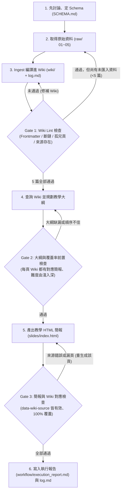

# 第十週作業繳交內容範本（可直接複製修改標題後繳交）

> **繳交標題格式**：`學校 學號 系級 姓名 RAG（檢索增強生成）LLM Wiki 與教學簡報`
> （請將「學校、學號、系級、姓名」替換為你的實際資訊）

---

## 1. LLM Wiki 主題與簡短介紹
- **主題**：**RAG（檢索增強生成，Retrieval-Augmented Generation）**
- **簡介**：本知識庫採用「先討論、後生成」的方式建立，先制定 `SCHEMA.md` 規範目錄結構、YAML Frontmatter 欄位、`[[wikilink]]` 雙向連結與來源追溯規則，再依序 **ingest 5 篇原始技術文獻**（從 Lewis et al. 2020 奠基論文、切塊與向量嵌入、雙階段管線架構、進階 RAG 與 RAGAS 評估，一路延伸到 RAG vs. Fine-tuning vs. Long Context vs. LLM Wiki 的技術選型）。透過寫入時預先編譯，將 5 篇原始資料整合為 6 頁互聯的結構化知識頁面，並以該 Wiki 作為唯一知識來源製作出 12 頁新手友善的互動式教學 HTML 簡報。

---

## 2. LLM Wiki 連結或成果
- **專案目錄結構**（若上傳至 GitHub，請填入你的 Repo 連結：`https://github.com/<你的帳號>/<Repo名稱>`）：
  - `SCHEMA.md`：Wiki 規範與 Ingest / Lint / Query 操作流程
  - `raw/`（共 5 篇不可變原始資料）：
    1. `raw/01_rag_original_paper.md` — Lewis et al. (2020) RAG 奠基論文
    2. `raw/02_embeddings_and_vector_db.md` — 切塊、向量嵌入與向量資料庫
    3. `raw/03_rag_pipeline_architecture.md` — RAG 離線索引與線上查詢雙階段架構
    4. `raw/04_advanced_rag_and_evaluation.md` — 進階 RAG 優化（Hybrid Search / Rerank）與 RAGAS 評估
    5. `raw/05_rag_vs_finetuning_vs_llm_wiki.md` — RAG vs. Fine-tuning vs. Long Context vs. LLM Wiki
  - `wiki/`（經編譯整合後的 6 個知識頁面）：
    - `wiki/index.md`（總目錄與學習路徑）
    - `wiki/concepts/what-is-rag.md`（對應 Slide 2–3）
    - `wiki/concepts/chunking-and-embeddings.md`（對應 Slide 4–5）
    - `wiki/concepts/rag-pipeline.md`（對應 Slide 6–7）
    - `wiki/concepts/advanced-rag-and-eval.md`（對應 Slide 8–9）
    - `wiki/comparisons/rag-vs-alternatives.md`（對應 Slide 10–11）
  - `log.md`：完整記錄 INIT、5 次 INGEST、BUILD_SLIDES 與 2 次 LINT & CHECK 的時間軸日誌

---

## 3. 教學 HTML 簡報連結
- **簡報檔案**：`slides/index.html`（若已開啟 GitHub Pages，請填入：`https://<你的帳號>.github.io/<Repo名稱>/slides/`）
- **教學結構與特色**：
  - 共 12 頁單檔離線可瀏覽 HTML 簡報，支援鍵盤 `←` / `→` / `Space` 翻頁、進度條與目錄快跳。
  - 從「純 LLM 三大痛點 → 開書考試類比 → 切塊與向量 → 雙階段架構 → 進階優化與 RAGAS → 四大方案選型與 LLM Wiki 對照」循序漸進，並於第 12 頁設計 **3 題互動隨堂測驗**。
  - 每張投影片皆標示對應的 `data-wiki-source` 與頁尾來源徽章，確保 100% 對應至 Wiki 頁面。

---

## 4. Loop / Graph 的流程圖與文字說明

### 流程圖（雙迴圈 + 三道檢查閘門）

### 設計重點說明
- **哪些步驟會重複執行？**
  1. **Ingest Loop（步驟 2 → 3 → Gate 1）**：每匯入 1 篇原始資料就執行編譯與結構檢查，共重複 5 次，確保知識是增量累積並即時維護雙向連結。
  2. **Slide Check Loop（步驟 4 → Gate 2 / 步驟 5 → Gate 3）**：若大綱覆蓋率不足或簡報來源標註錯誤，會局部退回修正並重新檢查，直到完全通過。
- **哪些地方需要檢查或重新生成？**
  - **Gate 1（Wiki Lint）**：自動化檢查 Frontmatter 必填欄位、`sources` 是否指向實際存在的 `raw/` 檔案、`[[wikilink]]` 斷鏈與孤兒頁。
  - **Gate 2（大綱前置檢查）**：在動手寫 HTML 前先核對 6 個 Wiki 頁面與 12 張投影片的教學順序與覆蓋關係。
  - **Gate 3（簡報稽核）**：解析 `slides/index.html` 中每一張投影片的 `data-wiki-source`，驗證來源全部有效且 100% 涵蓋所有 Wiki 頁面。
- **為什麼這樣設計？**
  - 將「知識編譯」與「簡報呈現」解耦，並在每個階段出口設置可由程式自動驗證的檢查點（Gates），讓錯誤盡早暴露（Fail Fast），避免直接從原始資料一次生成簡報導致遺漏重點或產生幻覺。

---

## 5. 一次實際執行的結果與檢查紀錄

透過自動化檢查腳本（`workflow/run_pipeline_check.ps1` / `workflow/run_pipeline_check.py`）實際執行完整驗證：

### 第 1 次執行（2026-11-21 15:14:23）— **FAILED**
- **Gate 0（Raw 數量）**：PASS（偵測到 5 篇原始資料）
- **Gate 1（Wiki Lint）**：**FAILED**
  - 抓到異常：`[斷鏈] wiki/comparisons/rag-vs-alternatives.md 中的 [[wikilink]] 找不到對應 Wiki 頁面`
- **Gate 3（Slides 對應）**：PASS（12 張投影片皆有效對應，Wiki 覆蓋率 6 / 6 = 100%）
- **診斷與處置**：檢查後發現 `rag-vs-alternatives.md` 內文將 `` `[[wikilink]]` `` 寫在反引號行內程式碼中作為語法示範，而 Lint 規則未先排除行內程式碼區段，導致誤判為斷鏈。修正腳本在掃描 `[[...]]` 前先過濾 `` `[^`]+` `` 後重新執行。

### 第 2 次執行（2026-11-21 15:16:40）— **ALL PASSED**
- **Gate 0**：PASS（5 / 5 篇原始資料）
- **Gate 1**：PASS（6 / 6 個 Wiki 頁面 Frontmatter、來源引用、`[[wikilink]]` 雙向連結、孤兒頁檢查全數通過）
- **Gate 3**：PASS（12 / 12 張投影片 `data-wiki-source` 皆有效，Wiki 覆蓋率 **100%**）

| 頁碼 | 投影片標題 | 對應 Wiki 來源 | 狀態 |
| :--- | :--- | :--- | :--- |
| Slide 1 | 封面：RAG 新手完全入門 | `wiki/index.md` | OK |
| Slide 2 | 為什麼純 LLM 還不夠？ | `wiki/concepts/what-is-rag.md` | OK |
| Slide 3 | 什麼是 RAG？開書考試類比 | `wiki/concepts/what-is-rag.md` | OK |
| Slide 4 | 底層原理 I：Text Chunking | `wiki/concepts/chunking-and-embeddings.md` | OK |
| Slide 5 | 底層原理 II：Embedding 與向量庫 | `wiki/concepts/chunking-and-embeddings.md` | OK |
| Slide 6 | 系統架構 I：離線索引階段 | `wiki/concepts/rag-pipeline.md` | OK |
| Slide 7 | 系統架構 II：線上查詢與生成 | `wiki/concepts/rag-pipeline.md` | OK |
| Slide 8 | 進階 RAG 三大優化技巧 | `wiki/concepts/advanced-rag-and-eval.md` | OK |
| Slide 9 | RAGAS 三角評估指標 | `wiki/concepts/advanced-rag-and-eval.md` | OK |
| Slide 10 | 技術選型：四大方案比較 | `wiki/comparisons/rag-vs-alternatives.md` | OK |
| Slide 11 | 傳統 RAG vs. LLM Wiki | `wiki/comparisons/rag-vs-alternatives.md` | OK |
| Slide 12 | 互動隨堂小測驗與總結 | `wiki/index.md` | OK |

---

## 6. 反思：哪個節點最常出錯？你如何調整檢查流程？

1. **哪一個節點最常出錯？**
   - **「Wiki 編譯與連結維護（Ingest → Gate 1）」** 與 **「簡報來源對應（Compile Slides → Gate 3）」** 最容易出錯。在實作過程中，即使內容本身正確，也容易出現 `[[wikilink]]` 語法示範與真實連結混淆、Frontmatter 欄位缺漏，或是在生成簡報時遺漏某些 Wiki 頁面。
2. **你發現問題後，把檢查往前移到了哪一個步驟？**
   - 將原本放在最後人工目測的檢查往前移成兩道前置關卡：
     - **往前移至每篇 Ingest 結束後（Gate 1）**：每次匯入完就立刻檢查 Frontmatter、來源存在性與雙向連結，不讓格式與連結錯誤帶到簡報階段。
     - **往前移至撰寫 HTML 簡報之前（Gate 2）**：先核對「Wiki 頁面 ↔ 簡報頁碼」大綱對應表與教學順序，確認無漏頁後再生成 HTML。
3. **你有沒有因此修改 workflow / graph？為什麼？**
   - **有**。我將原本單向線性的流程改寫為 **雙迴圈 + 三道 Gate 的 Graph**，並在第 1 次執行 Gate 1 攔截到行內程式碼 `` `[[wikilink]]` `` 誤報後，立即修正了 Lint 解析規則（先排除 inline code 再驗證真實 `[[wikilink]]`）。這樣修改的理由是：自動化 Gate 必須同時具備「**早期攔截真錯誤**」與「**不產生誤報干擾流程**」兩種特性，整個 Loop 才能穩定反覆執行。
